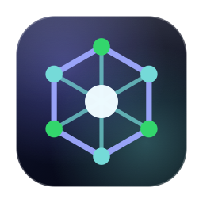
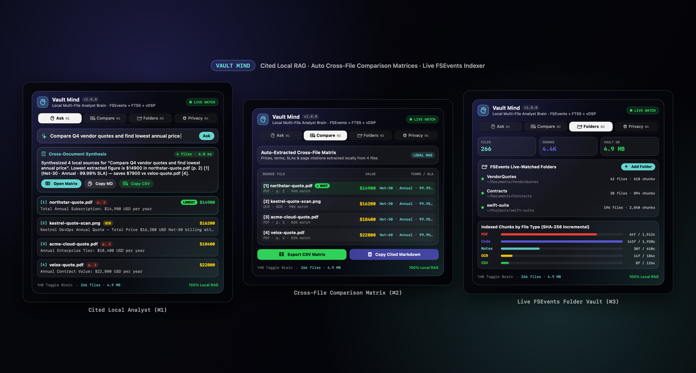
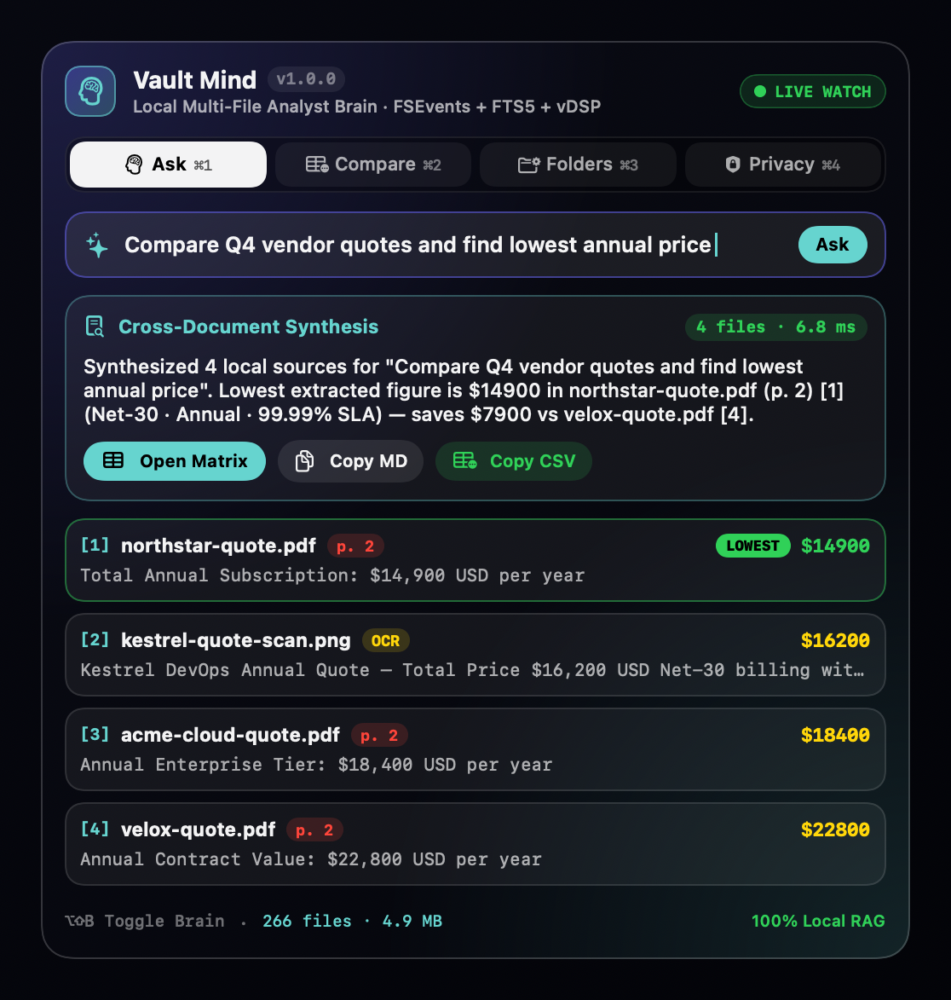
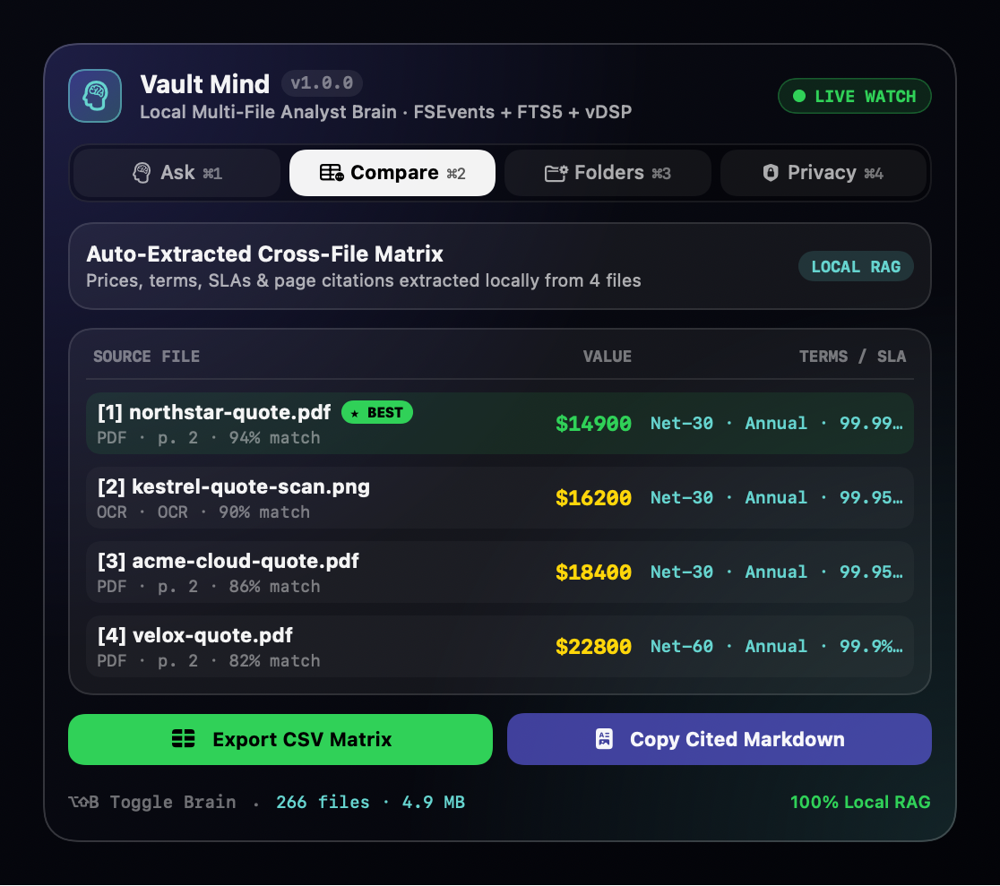
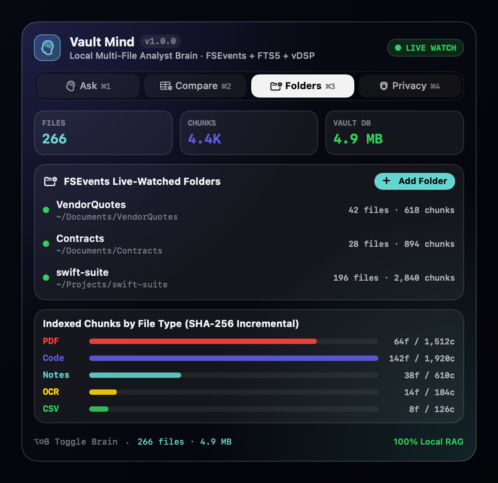
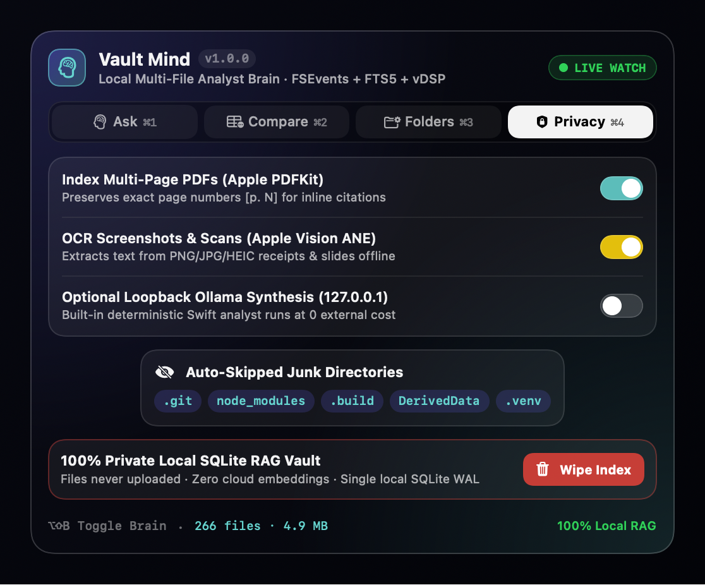
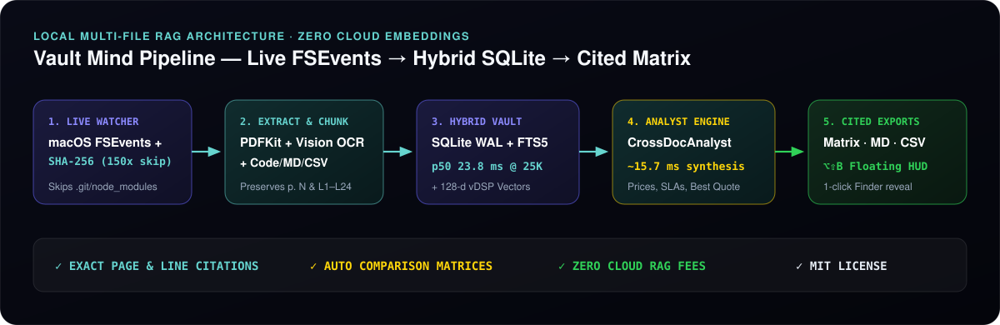
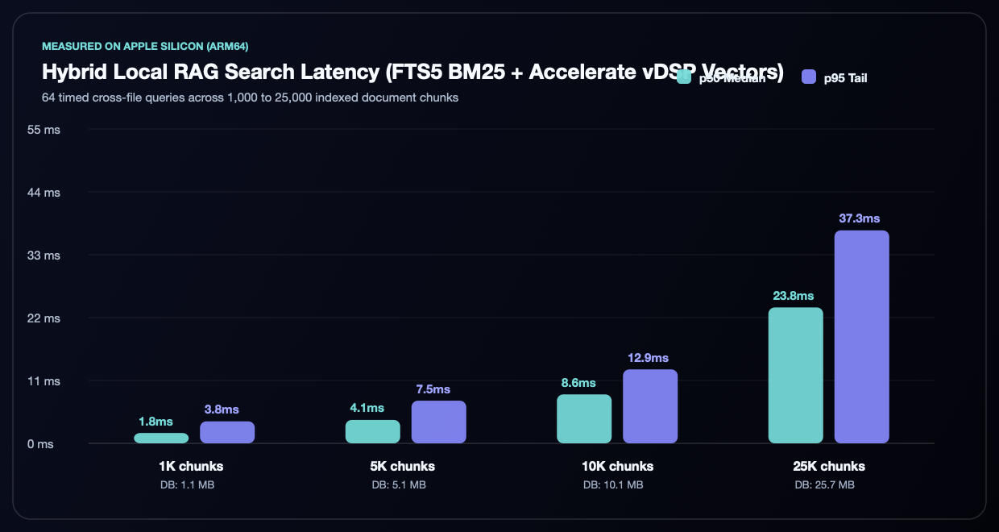
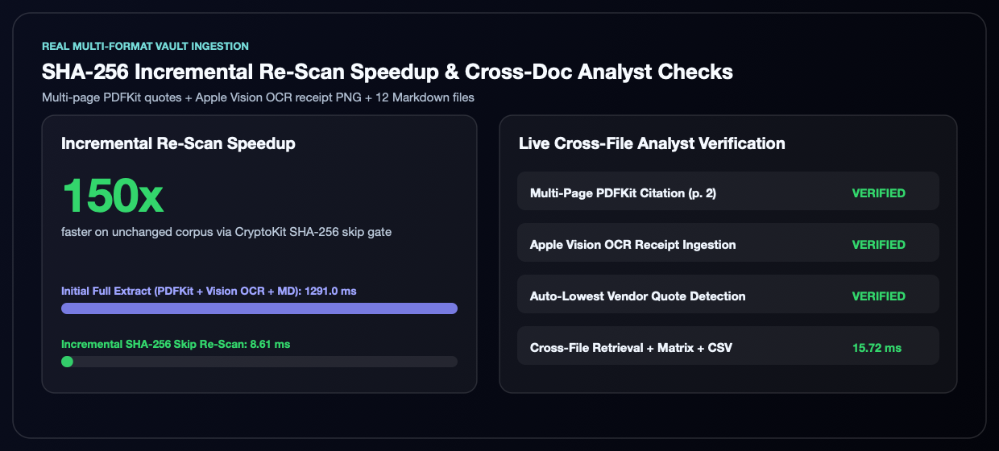
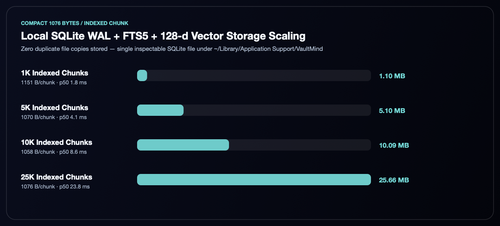

<div align="center">



# Vault Mind

**Local multi-file analyst brain for macOS — live-index PDFs, screenshots, Markdown, CSV & code via `FSEvents`, ask cross-document questions with exact page/line citations, and export clean comparison matrices.**

Built in pure **Swift 6** for Apple Silicon (macOS 15+).  
**Zero cloud RAG fees. Zero file uploads. Zero third-party dependencies. Zero subscriptions.**

[](https://github.com/Moeraafatz/vault-mind/releases/latest)

<br />

[](#installation)
[](#measured-performance--graphs)
[](#architecture)
[](#privacy--local-rag-model)
[](LICENSE)

<br />



</div>

---

## Why Vault Mind?

Cloud RAG workspaces force you to upload confidential contracts, vendor quotes, invoices, and private repos to external servers and pay **$20–$40/month** — while macOS Spotlight can only find filenames without comparing clauses or pricing across documents.

**Vault Mind** turns chosen folders on your Mac into an instant offline analyst (`⌥⇧B`): it watches changes via native **`FSEvents`** with **`CryptoKit` SHA-256** change skipping, extracts multi-page PDFs (`PDFKit`), scans/screenshots (`Vision` OCR), Markdown, CSV, and code into a compact local **SQLite WAL + FTS5 + 128-d `Accelerate` (`vDSP`) vector** vault, answers cross-document questions with exact `[file · p. N]` citations, highlights the lowest quote automatically, and exports publication-ready **Markdown & CSV comparison tables** in one click.

| | **Vault Mind** | Cloud RAG SaaS (NotebookLM / ChatPDF / Glean) | macOS Spotlight | Manual Cross-Reading |
| :--- | :---: | :---: | :---: | :---: |
| **Price** | **Free & Open Source (MIT)** | $20–$40/mo | Free | Free (costs hours/wk) |
| **Zero Cloud Uploads (Private Contracts/Code)** | ✅ 100% local SQLite WAL | ❌ Uploads files to cloud | ✅ Local | ✅ |
| **Live `FSEvents` Auto-Sync + SHA-256 Skip** | ✅ Instant folder watch | ❌ Manual re-upload | ✅ | N/A |
| **Multi-Page `PDFKit` + `Vision` OCR Citations** | ✅ Exact `[file.pdf · p. 2]` | ⚠️ Varies | ❌ No page synthesis | Manual |
| **Auto Cross-File Price/SLA Matrix + CSV Export** | ✅ 1-click Matrix / CSV / MD | ⚠️ Prompt-dependent | ❌ | Manual spreadsheet |
| **Hybrid FTS5 + `vDSP` 128-d Vector Retrieval** | ✅ Offline Apple Silicon | Cloud vectors | Lexical only | N/A |

---

## Screenshots

Every screenshot below is rendered directly from the compiled SwiftUI `VaultMindUI` binary on Apple Silicon CI (`macos-latest`).

<table>
  <tr>
    <td align="center" width="50%">
      <br />
      <strong>Cited Local Analyst (<code>⌘1</code> · <code>⌥⇧B</code>)</strong><br />
      <sub>Cross-file executive synthesis with inline <code>[1]</code>–<code>[4]</code> citations, exact page/OCR badges, auto <code>LOWEST</code> callout &amp; 1-click Finder reveal</sub>
    </td>
    <td align="center" width="50%">
      <br />
      <strong>Cross-File Comparison Matrix (<code>⌘2</code>)</strong><br />
      <sub>Auto-extracted pricing, Net-30/SLA terms, best-value highlight &amp; 1-click Export CSV / Copy Cited Markdown</sub>
    </td>
  </tr>
  <tr>
    <td align="center" width="50%">
      <br />
      <strong>Live FSEvents Folder Vault (<code>⌘3</code>)</strong><br />
      <sub>Real-time macOS <code>FSEvents</code> directory watchers, indexed chunk counts, SQLite WAL size &amp; file-type distribution</sub>
    </td>
    <td align="center" width="50%">
      <br />
      <strong>Privacy &amp; Extractor Controls (<code>⌘4</code>)</strong><br />
      <sub>Toggle PDFKit/Vision OCR/loopback-only Ollama, auto-skipped <code>.git</code>/<code>node_modules</code>/<code>DerivedData</code> guardrails &amp; 1-click Wipe Index</sub>
    </td>
  </tr>
</table>

---

## Architecture

<p align="center">
  
</p>

1. **Real-Time Watcher + SHA-256 Gate (`FolderWatcher`)** — Uses native `FSEvents` (`FSEventStreamCreate` on a dedicated background queue) and `CryptoKit` SHA-256 hashes to skip unchanged files instantly while ignoring `.git`, `node_modules`, `.build`, `DerivedData`, and `.venv`.
2. **Multi-Format Extractor & Chunker (`DocumentExtractor`)** — Reads multi-page PDFs page-by-page (`PDFKit` → `p. 1`, `p. 2`), screenshots/scans via offline Apple `Vision` OCR (`OCR`), and code/Markdown/CSV with exact line spans (`L1–L24`).
3. **Hybrid SQLite WAL + `vDSP` Vector Store (`VaultStore` + `VectorIndex`)** — Indexes text in SQLite `FTS5` (`porter unicode61`, `bm25()`) alongside 128-dim Float32 L2-normalized vectors scored with `Accelerate` (`vDSP_dotpr`) using Reciprocal Rank Fusion.
4. **Cross-Document Analyst (`CrossDocAnalyst`)** — Deduplicates top evidence across distinct source files, extracts monetary amounts (`$14,900`, `USD`), Net-30/60 terms, SLAs (`99.99%`), and notice windows, highlights the lowest offer automatically, and builds cited Markdown & RFC-4180 CSV reports.

---

## Measured Performance & Graphs

All charts and numbers below are **measured live on Apple Silicon CI** via `VaultMindTools` (`VaultBenchmarkRunner`), never estimated or mocked.

<p align="center">
  
</p>

<table>
  <tr>
    <td width="50%">
      
    </td>
    <td width="50%">
      
    </td>
  </tr>
</table>

<!-- BENCHMARK_TABLE_START -->
### Measured Benchmarks (Apple Silicon (arm64) · Version 26.7.2 (Build 25G332))

- **SHA-256 Incremental Re-Scan:** `8.61 ms` vs `1291.0 ms` initial full extract (**`150x` speedup**)
- **Cross-Document Analyst Synthesis:** **`15.72 ms`** · Multi-page `PDFKit` page citation (**PASS**) · `Vision` OCR receipt (**PASS**) · Auto lowest-quote match (**PASS**)

| Indexed Chunks | SQLite WAL Size | Bytes / Chunk | Hybrid Search p50 | Hybrid Search p95 |
| ---: | ---: | ---: | ---: | ---: |
| 1000 chunks | 1.10 MB | 1151 B | **1.81 ms** | **3.85 ms** |
| 5000 chunks | 5.10 MB | 1070 B | **4.10 ms** | **7.46 ms** |
| 10000 chunks | 10.09 MB | 1058 B | **8.56 ms** | **12.94 ms** |
| 25000 chunks | 25.66 MB | 1076 B | **23.78 ms** | **37.26 ms** |
<!-- BENCHMARK_TABLE_END -->

---

## Privacy & Local RAG Model

- **Zero cloud uploads:** Your PDFs, vendor quotes, contracts, receipts, and codebases never leave your Mac.
- **Single inspectable vault:** Everything lives in `~/Library/Application Support/VaultMind/vault.sqlite` — back up or delete anytime.
- **Zero root / zero subscriptions:** Pure user-space macOS frameworks (`FSEvents`, `PDFKit`, `Vision`, `Accelerate`, `CryptoKit`, `SQLite3`).

---

## Installation

### Download DMG (Recommended)
1. Download `VaultMind-1.0.0.dmg` from the [Latest Release](https://github.com/Moeraafatz/vault-mind/releases/latest).
2. Drag **Vault Mind** into `/Applications`.
3. Clear Gatekeeper quarantine once for this free ad-hoc signed open-source build:
   ```bash
   xattr -dr com.apple.quarantine /Applications/VaultMind.app
   ```
4. Launch **Vault Mind**, add folders to watch in **Folders (`⌘3`)**, and press **`⌥⇧B`** anytime to ask across your local files.

### Build from Source (Zero Dependencies)
```bash
git clone https://github.com/Moeraafatz/vault-mind.git
cd vault-mind
swift test
swift build -c release
.build/release/VaultMindTools
./Scripts/package_release.sh 1.0.0
```

---

## Keyboard Shortcuts

| Shortcut | Action |
| :--- | :--- |
| `⌥⇧B` | Toggle floating Vault Mind Analyst HUD from any app |
| `⌘1` | Jump to **Ask** cited cross-document analyst |
| `⌘2` | Jump to **Compare** auto-generated matrix & CSV/MD export |
| `⌘3` | Jump to **Folders** live `FSEvents` watchers & file stats |
| `⌘4` | Jump to **Privacy** extractor toggles & vault wipe |

---

## License

MIT © [Moeraafatz](https://github.com/Moeraafatz)
